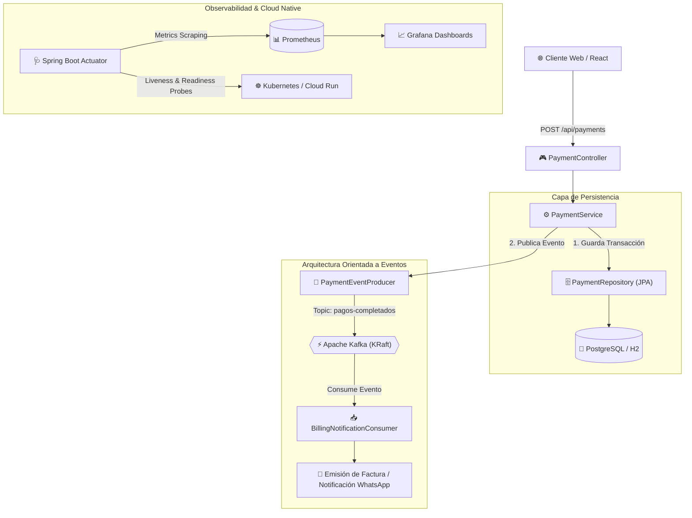

# Enterprise Event Hub & Smart Billing Platform 🚀

[](https://openjdk.org/)
[](https://spring.io/projects/spring-boot)
[](https://kafka.apache.org/)
[](https://www.postgresql.org/)
[](https://www.docker.com/)
[](https://github.com/features/actions)
[](https://prometheus.io/)
[](https://grafana.com/)

Plataforma empresarial de procesamiento de pagos y facturación en tiempo real construida con arquitectura **Full Stack Enterprise & Event-Driven** (Microservicios, Apache Kafka, Spring Boot con Java 21 LTS, Spring Data JPA y observabilidad con Prometheus/Grafana).

Desarrollada por **Xavier Cedeño Febres** bajo el paradigma de **Ingeniería AI-First**.

---

## 🏛️ Arquitectura del Sistema



---

## 🛠️ Matriz Tecnológica

- **Backend:** Java 21 LTS, Spring Boot 4, Spring Web MVC, Spring Data JPA, Spring Kafka.
- **Event Streaming:** Apache Kafka en modo KRaft (sin dependencia de Zookeeper).
- **Persistencia:** PostgreSQL 16 y H2 in-memory (compatibilidad PostgreSQL para desarrollo local).
- **Contenedores & DevOps:** Docker Multi-stage (~140MB final), Docker Compose, GitHub Actions CI/CD.
- **Cloud & Orquestación:** Google Cloud Run v2 (Terraform IaC) y manifiestos de Kubernetes con sondas de autorecuperación (`livenessProbe` / `readinessProbe`).
- **Observabilidad:** Micrometer Prometheus Registry, Spring Actuator, Prometheus y Grafana.
- **Testing:** JUnit 5, Mockito, MockMvc (100% pruebas unitarias e integración pasando).

---

## 🚀 Inicio Rápido (Quickstart)

### Requisitos Previos
- **Java 21 LTS** o superior.
- **Docker & Docker Compose** (opcional para correr Postgres y Kafka externos).

### 1. Clonar y Compilar
```bash
git clone https://github.com/xcedeno/enterprise-backend.git
cd enterprise-backend
./mvnw clean compile
```

### 2. Ejecutar Pruebas Automatizadas
```bash
./mvnw test
```
*Salida esperada:*
```text
[INFO] Tests run: 5, Failures: 0, Errors: 0, Skipped: 0
[INFO] BUILD SUCCESS
```

### 3. Iniciar el Servidor
```bash
./mvnw spring-boot:run
```
La aplicación iniciará en `http://localhost:8080`.

---

## 📡 Endpoints de la API

| Método | Endpoint | Descripción |
| :--- | :--- | :--- |
| `GET` | `/api/status` | Estado del microservicio e información de salud. |
| `GET` | `/api/payments` | Obtiene el listado completo de pagos registrados. |
| `GET` | `/api/payments/{id}` | Consulta el detalle de un pago por su ID. |
| `GET` | `/api/payments/unit/{unit}` | Filtra los pagos asociados a un apartamento/unidad. |
| `POST` | `/api/payments` | Registra un nuevo pago y dispara el evento en Kafka. |
| `GET` | `/actuator/health` | Sondas de salud para Kubernetes (`liveness` y `readiness`). |
| `GET` | `/actuator/prometheus` | Métricas en formato abierto para raspado de Prometheus. |

### Ejemplo: Registrar un Pago (cURL)
```bash
curl -X POST http://localhost:8080/api/payments \
  -H "Content-Type: application/json" \
  -d '{
    "residentName": "Carlos Mendoza",
    "apartmentUnit": "4B",
    "amount": 75.50
  }'
```

---

## 🐳 Infraestructura con Docker Compose
Para levantar la base de datos PostgreSQL, Apache Kafka, Prometheus y Grafana en un solo comando:
```bash
docker compose up -d
```
- **PostgreSQL:** `localhost:5432`
- **Apache Kafka:** `localhost:9092`
- **Prometheus:** `http://localhost:9090`
- **Grafana:** `http://localhost:3000` (User: `admin`, Password: `admin`)

---

## 👤 Autor
**Xavier Cedeño Febres**  
- **Portafolio:** [miportafolio-sage.vercel.app](https://miportafolio-sage.vercel.app/)  
- **LinkedIn:** [linkedin.com/in/xavier-febres-13777b120](https://www.linkedin.com/in/xavier-febres-13777b120/)  
- **GitHub:** [github.com/xcedeno](https://github.com/xcedeno)

